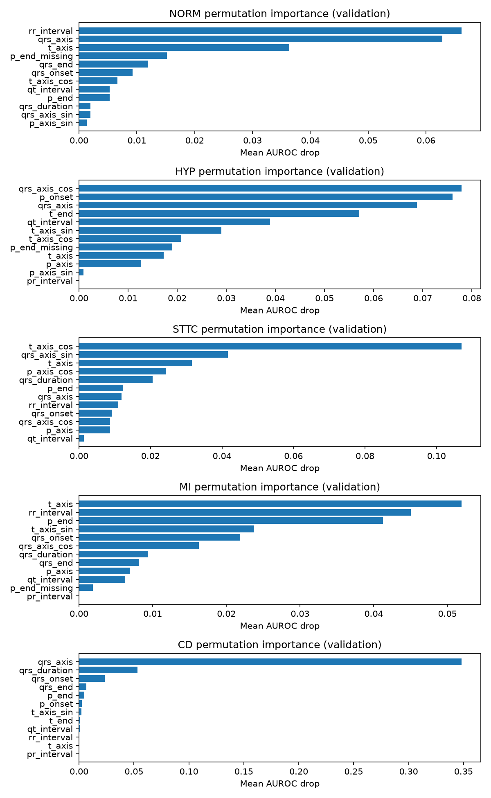
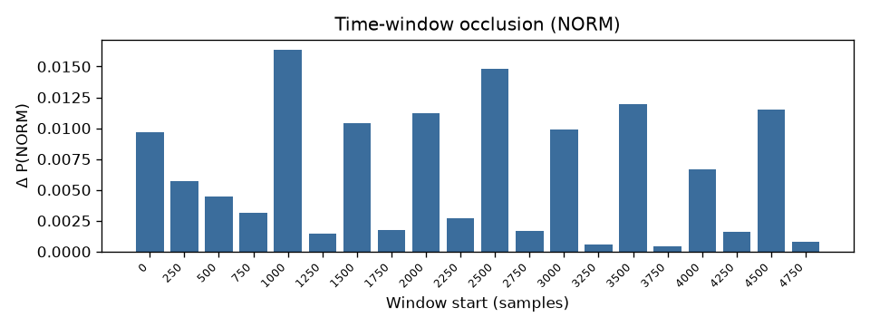

<!--
Phase 3 Final Report. Print or convert to PDF/Word with Times New Roman to match
the official template (title 24 pt; authors 11 pt; affiliation 10 pt italic;
email 9 pt Courier; body 10 pt justified single column A4). Do not add page
numbers, headers, or footers in the manuscript body. Complete registration
numbers and handwritten signatures on the contribution page before submission.
-->

Explainable Multimodal ECG Diagnostic Classification Using Waveforms and Clinical Text

Arushi Ajmani1, Yamini Prabha B.1, Sruthi1

Undergraduate Mini Project, Phase 3 Final Report, Academic Year 2026

arushiajmani08@gmail.com, yaminiprabhaclg@gmail.com

Abstract—Automated electrocardiogram (ECG) interpretation is widely studied as a waveform-only learning problem, yet hospital ECGs are routinely stored with machine-written reports that describe rhythm, morphology, and conduction. This mini project asks whether combining 12-lead waveforms with leakage-controlled residual report text improves five-label diagnostic classification relative to unimodal baselines, and whether gated modality attention outperforms simple concatenation. The dataset is a computationally manageable slice of MIMIC-IV-ECG v1.0. Targets are weak multi-label rules for NORM, HYP, STTC, MI, and CD mined from machine reports; they are not cardiologist-adjudicated diagnoses. Four core models share a frozen patient-level 70/15/15 split (seed 42): a 1D convolutional network on raw signals of shape (12, 5000); a bidirectional long short-term memory (LSTM) network on residual text after masking label-trigger phrases; concatenation of the two encoder embeddings; and gated softmax fusion of the same embeddings. An extra tabular baseline uses cart measurements with random forest, XGBoost, and logistic regression. Thresholds are chosen on validation F1 only. Fair comparison uses the 15 test studies that have residual text and a usable waveform. On that cohort, the measurement baseline attained the highest macro F1 (0.463), followed by residual text (0.392), gated fusion (0.348), the ECG convolutional network (0.325), and concat fusion (0.264). Fusion did not beat the stronger unimodal models on this small slice. Scores measure agreement with weak labels, not clinical accuracy.

Keywords—electrocardiogram, multimodal fusion, clinical text, 1D convolutional neural network, LSTM, attention, weak labels, explainability, MIMIC-IV-ECG, leakage control

<h1 class="sec">I. Introduction</h1>

Electrocardiography remains a first-line, low-cost recording of cardiac electrical activity. Deep neural networks have reached cardiologist-level performance on selected arrhythmia tasks from raw traces, but most published systems still treat the waveform as the only input. In electronic health records, each diagnostic ECG is typically accompanied by a machine-generated report: a short, templated narrative of rhythm, intervals, hypertrophy language, ST/T change, infarct statements, and conduction findings. Those reports are complementary to the voltage time series, yet they also create a methodological trap: if diagnostic labels are themselves extracted from the same sentences, a text model can “succeed” by recovering the labeling rules rather than by learning physiology.

This mini project studies a narrower, controlled question. Given a shared patient-level split and five broad diagnostic buckets, do 12-lead waveforms plus residual clinical text outperform waveform-only or text-only models, and does a gated attention fusion improve on concatenating the two embeddings? The work is scoped as a research prototype on MIMIC-IV-ECG, not as a deployable diagnostic device. Labels are frozen rule-based weak targets. Trigger phrases that created those labels are removed before text is shown to Models 2, 3, and 4. Identifiers are never features. Thresholds are fit on validation data only. Explainability is limited to occlusion of time windows, leads, and tokens, plus inspectable fusion gates and permutation importance for the tabular baseline.

The contribution of the project is an end-to-end, leakage-aware comparison of four architectures (plus one extra measurement baseline) under a common protocol, with a documented laptop-scale cohort, error analysis, and attribution plots. The empirical finding on the available waveform slice is that fusion is not automatically better: compact cart measurements and residual text currently outrank both fusion heads, while concatenation is the weakest of the five compared systems.

<h1 class="sec">II. Literature Review</h1>

Public ECG resources made large-scale supervised learning feasible. Goldberger et al. established PhysioNet as a shared physiologic-signal archive [1]. Wagner et al. released PTB-XL, a 12-lead dataset with SCP-ECG superclasses that include Normal, Hypertrophy, ST/T change, Myocardial Infarction, and Conduction Disturbance—the same five buckets used here as weak targets [2]. Strodthoff et al. then benchmarked convolutional and recurrent ECG classifiers on PTB-XL and showed that 1D convolutional networks are strong, reproducible baselines for multi-label ECG diagnosis [3]. Gow et al. released MIMIC-IV-ECG, pairing approximately 800,000 diagnostic 12-lead recordings at 500 Hz with machine measurements and machine reports inside the MIMIC-IV ecosystem described by Johnson et al. [4], [5]. That pairing is the data foundation of this project.

Waveform-only deep learning is now a mature line of work. Hannun et al. demonstrated cardiologist-level arrhythmia detection from ambulatory single-lead recordings with a 34-layer convolutional network [6]. Ribeiro et al. extended automatic 12-lead diagnosis to a large Brazilian telehealth corpus and reported high recognition of rhythm and conduction abnormalities [7]. Kiranyaz et al. showed that compact 1D convolutional networks can classify patient-specific ECG morphology in real time, motivating the encoder used as Model 1 and reused inside the fusion models [8]. These studies justify a convolutional unimodal baseline, but they do not answer whether report text adds complementary information once label leakage is controlled.

Clinical-text modeling in medicine has been driven by both sequence models and vision–language pretraining. Hochreiter and Schmidhuber introduced long short-term memory networks, which remain a practical encoder for short, templated report strings when pretrained transformers would be under-determined [9]. Irvin et al. showed that rule-based extraction of diagnostic mentions, including uncertainty and negation, can create large weak-label corpora; CheXpert’s mention rules are the conceptual ancestor of the ECG mapping used by MEDBind and adapted in this repository [10]. Gao et al. presented MEDBind, which binds chest radiographs, ECGs, and text into a joint embedding space using contrastive losses and, importantly for this project, derived Hypertrophy, ST/T change, Normal, Myocardial Infarction, and Conduction Disorder labels from MIMIC-ECG reports with a rule-based procedure [11]. Contrastive image–text work such as CLIP and GLoRIA further established that language can supervise physiologic or radiographic encoders [12], [13]. Those papers motivate multimodal ECG–text learning; they do not, however, isolate whether a simple fusion head beats unimodal classifiers under a frozen split and explicit trigger masking.

Fusion design is itself a research choice. Vaswani et al. made attention the default mechanism for weighting representations [14]. Arevalo et al. proposed gated multimodal units that learn how much each modality should contribute, which is the conceptual source of Model 4’s two-gate softmax [15]. Concatenation remains the simplest multimodal baseline and is therefore Model 3. For tabular cart measurements, Breiman’s random forests and Chen and Guestrin’s XGBoost are standard, strong baselines when the input is already a vector of intervals and axes rather than a raw trace [16], [17]. Finally, Zeiler and Fergus popularized occlusion as a sensitivity probe for convolutional networks; this project uses time-window and lead occlusion on ECG branches and token occlusion on text rather than claiming that attention weights are causal explanations [18].

Taken together, the literature supports four design decisions: five PTB-XL-style superclasses as targets [2], [11]; a 1D convolutional waveform encoder [3], [8]; residual-text modeling with leakage controls because labels come from reports [10], [11]; and an explicit concat-versus-gate comparison rather than a large contrastive pretrainer [14], [15]. The gap this mini project fills is empirical and methodological: a same-split, same-label, leakage-aware classification comparison on MIMIC-IV-ECG, not another retrieval or zero-shot pretraining result.

<h1 class="sec">III. Objectives</h1>

The synopsis objectives were refined to match the implemented protocol and the actual cohort sizes.

<b>O1.</b> Train and evaluate unimodal baselines—an ECG-only 1D convolutional network and a residual-text bidirectional LSTM—on the same frozen five-label mapping (v1.0.0) and the same patient-level 70/15/15 split (seed 42), reporting macro F1, micro F1, and macro AUROC on held-out test studies.

<b>O2.</b> Compare concatenation fusion and gated modality-attention fusion of the two encoders against those unimodal baselines on the inner-join common test cohort (studies with residual text and a usable 12-lead waveform), and test whether gated fusion improves macro F1 over concatenation.

<b>O3.</b> Produce leakage-aware evidence: a residual-text audit, validation-only thresholds, occlusion or permutation explanations, and a label-wise error analysis, without claiming clinical diagnostic accuracy.

<h1 class="sec">IV. Methodology</h1>

All neural models emit five independent logits and are trained with binary cross-entropy with logits (no softmax), matching the multi-label nature of ECG findings. Positive class weights, when used, are computed from training counts only. Adam is the optimizer. Random seed 42 is used throughout.

<h2 class="sub">A. Model 1: ECG-Only 1D Convolutional Network</h2>

Model 1 receives a tensor of shape (batch, 12, 5000), corresponding to 12 leads sampled at 500 Hz for 10 s. The encoder comprises four Conv1d–BatchNorm–ReLU–MaxPool blocks with channel widths 32, 64, 128, and 128, kernel size 7, and pool factors 2, 2, 5, and 5. Adaptive average pooling collapses the time axis; a linear projection yields a 128-dimensional embedding; dropout (0.3) and a linear head produce five logits. Training uses batch size 16, learning rate 0.001, weight decay 10−4, at most eight epochs, and early stopping with patience 3 on validation loss. Per-lead z-score statistics are fit on training waveforms only. On the laptop slice the usable waveform set is 69 records (35 / 19 / 15 train / validation / test).

This model was chosen because convolutional 1D stacks are the established waveform baseline in PTB-XL benchmarks and because the encoder can be reused, without architectural change, as the ECG branch of Models 3 and 4 [3], [8]. It answers how much of the weak-label task is recoverable from voltage morphology alone.

<h2 class="sub">B. Model 2: Residual-Text Bidirectional LSTM</h2>

Model 2 never sees waveforms or numeric measurements. Report fields <code>report_0</code>…<code>report_17</code> are concatenated, labeling rules are applied, and every statement that fired a rule is dropped, along with summary phrases such as “normal ECG,” “abnormal ECG,” and “within normal limits.” The surviving residual text is tokenized with a vocabulary fit on training documents only (minimum frequency 2; maximum length from the 95th training percentile, capped at 64). The network is an embedding of size 64, a one-layer bidirectional LSTM with hidden size 64, dropout 0.3, and a linear map from the concatenated final states (128) to five logits. Packed sequences exclude padding. Batch size is 32; other training hyperparameters match Model 1. On the working cohort of 500 sampled studies, 523 labeled studies remain after filtering, split 388 / 54 / 81 by patient.

This model was chosen as the text-only baseline required by the research question and as the source of truth for labels, split, and residual text reused by every later model. An LSTM is appropriate because residual reports are short (median two tokens after masking) and because a large pretrained language model would be poorly identified at this sample size [9].

<h2 class="sub">C. Model 3: Concatenation Fusion</h2>

Model 3 reuses the Model 1 convolutional encoder and the Model 2 LSTM encoder. If <i>z</i>ecg ∈ ℝ128 and <i>z</i>text ∈ ℝ128 denote the two embeddings, logits are produced by a linear layer on their concatenation:

<i>logits</i> = Linear([<i>z</i>ecg; <i>z</i>text]).

Both encoders are fine-tuned. The text encoder uses a lower learning rate (3×10−4 versus 10−3 for the rest). Optional warm-start from Model 1 and Model 2 checkpoints is attempted with <code>strict=False</code>; on this slice the text checkpoint was skipped when vocabulary size differed between the full text cohort and the waveform subset. Dropout on the fused vector is 0.3. Batch size is 16. Training ran six epochs and restored the best validation-loss checkpoint (epoch 3).

Concatenation is the minimal multimodal hypothesis: if the two representations are complementary, a linear head should exploit the extra dimensions without introducing a learned routing mechanism. It is the required control against which attention fusion is judged.

<h2 class="sub">D. Model 4: Gated Modality-Attention Fusion</h2>

Model 4 uses the same encoders. Each embedding is projected to a shared dimension <i>d</i> = 128. A linear gate over the concatenated projections produces two scores that are normalized with softmax:

<i>a</i> = softmax(<i>W</i> [<i>P</i>(<i>z</i>ecg); <i>P</i>(<i>z</i>text)]),

<i>z</i> = <i>a</i>ecg <i>P</i>(<i>z</i>ecg) + <i>a</i>text <i>P</i>(<i>z</i>text),

<i>logits</i> = Linear(<i>z</i>).

Mean test gates on this run were 0.624 (ECG) and 0.376 (text). Gates are stored per study; they are inspectable mixing weights, not causal explanations [14], [15], [18]. Hyperparameters otherwise match Model 3. Early stopping restored epoch 1 after validation loss rose, indicating that the extra fusion parameters overfit quickly on 35 training waveforms.

This model was chosen to test whether learned modality weighting improves on concatenation under identical encoders, labels, and split—the second half of the research question. It is deliberately simpler than MEDBind-style contrastive pretraining so that any gain can be attributed to the fusion head rather than to a new self-supervised objective [11].

An extra tabular baseline (Model 2B) is not one of the four core architectures but is included in the comparison. It predicts the same labels from RR interval, fiducials, axes, derived PR/QRS/QT, and sine/cosine of axes after training-only median imputation, using random forest, XGBoost, and logistic regression selected on validation macro AUROC [16], [17]. Report text is forbidden as a feature.

<h1 class="sec">V. Experimental Setup</h1>

<h2 class="sub">A. Dataset and Cohort</h2>

The source is the MIMIC-IV-ECG Diagnostic Electrocardiogram Matched Subset, version 1.0, accessed under PhysioNet credentialed conditions [1], [4], [5]. Each study is identified by <code>subject_id</code> and <code>study_id</code>. Waveforms are 12-lead, 10 s, 500 Hz WFDB records. Text is the machine-report fields. Measurements are numeric cart summaries in <code>machine_measurements.csv</code>.

This report uses the laptop working cohort, not the full ~800,000-study dump. The local measurements table contains 2,500 rows. Model 2 sampled up to 500 studies (seed 42), produced 523 split studies after labeling, and retained residual text for training. After requiring at least one valid primary measurement, Model 2B used the same 388 / 54 / 81 split. Waveform indexing found 69 usable finite 12-lead records of length 5,000 among 523 split studies (452 files missing on disk). Fair multimodal comparison therefore uses <b>15 common test studies</b> that have both residual text and a usable waveform.

Table I. Working-cohort sizes used in this report (laptop slice, seed 42)

<table>
<thead>
<tr><th>Stage</th><th>Studies</th><th>Patients (where known)</th></tr>
</thead>
<tbody>
<tr><td>Local measurements CSV</td><td>2,500</td><td>—</td></tr>
<tr><td>Frozen split after Model 2 labeling</td><td>523</td><td>—</td></tr>
<tr><td>Train / validation / test (text, measurements)</td><td>388 / 54 / 81</td><td>70 / 15 / 15</td></tr>
<tr><td>Usable 12-lead waveforms</td><td>69</td><td>—</td></tr>
<tr><td>Waveform train / val / test</td><td>35 / 19 / 15</td><td>—</td></tr>
<tr><td>Common comparison test set</td><td>15</td><td>15 (comparison join)</td></tr>
</tbody>
</table>

<h2 class="sub">B. Labels and Leakage Controls</h2>

Mapping <code>artifacts/label_mapping.yaml</code> version 1.0.0 assigns five multi-label weak targets from report language, following the MEDBind/PTB-XL superclass taxonomy [2], [11]. NORM requires an explicit normal statement and is mutually exclusive with the other four. HYP covers hypertrophy and chamber enlargement. STTC covers ST/T change and ischemic ST/T language. MI requires infarct wording (isolated ischemia is STTC). CD covers blocks, pacing, WPW, axis deviation, and abnormal PR. Negated findings are not labeled; uncertain wording is labeled positive and flagged. Unmapped studies are excluded from classification.

Because the same reports generate both labels and Model 2/3/4 inputs, trigger statements and summary phrases are removed. On this slice, 0 of 542 audited studies still fired a primary labeling rule after masking; mean residual length was 4.5 tokens (median 2). Residual correlated clues remain (for example, 21 non-primary MI clues). Masking is therefore a control, not a proof of zero leakage. Patient-level splitting prevents the same <code>subject_id</code> from appearing in more than one partition.

<h2 class="sub">C. Preprocessing</h2>

ECG records are padded or truncated to 5,000 samples; non-finite or non-12-lead files are dropped. Normalization uses training-set per-lead z-scores. Text is lower-cased; the vocabulary and maximum length are training-only. Measurement sentinels (29999, 32767, 65535, and related codes) are treated as missing; derived intervals are computed only when both endpoints are valid and positive. Identifiers, cart ID, timestamps, bandwidth, and filtering metadata are never features.

<h2 class="sub">D. Evaluation Protocol</h2>

For each label, a threshold in {0.05, 0.10, …, 0.95} is chosen to maximize validation F1 (fallback 0.5 if fewer than five validation positives). Thresholds are then frozen. Metrics, computed identically for every model, are:

<ul>
<li>macro F1, precision, and recall (equal weight per label);</li>
<li>micro F1, precision, and recall (pooled true/false positives and negatives);</li>
<li>macro AUROC and AUPRC when both classes are present; otherwise the label is marked undefined.</li>
</ul>

IoU and BLEU are not applicable: this is multi-label classification, not segmentation or report generation. The comparison script inner-joins test <code>study_id</code>s so that every reported ranking uses the same 15 studies. Pairwise Hamming counts record which model is closer to the weak-label vector. Public error files use <code>example_id</code> rather than patient identifiers.

<h1 class="sec">VI. Results and Discussion</h1>

<h2 class="sub">A. Common-Cohort Comparison</h2>

Table II. Test metrics on the common 15-study cohort (agreement with weak labels, not clinical accuracy)

<table>
<thead>
<tr><th>Model</th><th>Macro F1</th><th>Micro F1</th><th>Macro AUROC</th><th>Macro AUPRC</th></tr>
</thead>
<tbody>
<tr><td>2B Measurements (XGBoost selected)</td><td>0.463</td><td>0.600</td><td>0.748</td><td>0.692</td></tr>
<tr><td>2 Residual-text LSTM</td><td>0.392</td><td>0.418</td><td>0.648</td><td>0.558</td></tr>
<tr><td>4 Gated fusion</td><td>0.348</td><td>0.444</td><td>0.591</td><td>0.498</td></tr>
<tr><td>1 ECG CNN</td><td>0.325</td><td>0.433</td><td>0.580</td><td>0.491</td></tr>
<tr><td>3 Concat fusion</td><td>0.264</td><td>0.444</td><td>0.507</td><td>0.393</td></tr>
</tbody>
</table>

Table III. Per-label F1 on the same 15 studies (MI support = 0)

<table>
<thead>
<tr><th>Model</th><th>NORM</th><th>HYP</th><th>STTC</th><th>MI</th><th>CD</th></tr>
</thead>
<tbody>
<tr><td>2B Measurements</td><td>0.571</td><td>0.000</td><td>0.909</td><td>0.000</td><td>0.833</td></tr>
<tr><td>2 Residual-text LSTM</td><td>0.556</td><td>0.333</td><td>0.571</td><td>0.000</td><td>0.500</td></tr>
<tr><td>4 Gated fusion</td><td>0.526</td><td>0.333</td><td>0.571</td><td>0.000</td><td>0.308</td></tr>
<tr><td>1 ECG CNN</td><td>0.500</td><td>0.353</td><td>0.571</td><td>0.000</td><td>0.200</td></tr>
<tr><td>3 Concat fusion</td><td>0.500</td><td>0.250</td><td>0.571</td><td>0.000</td><td>0.000</td></tr>
</tbody>
</table>

On the text-only test set of 81 studies, Model 2 achieved macro F1 0.429. Model 2B XGBoost achieved 0.472 on the same 81 studies (random forest 0.460; logistic regression 0.428). Those larger-n numbers are consistent in ranking with Table II but are not used to compare waveform models, which never saw the 81-study set.

<h2 class="sub">B. Why Performance Differs</h2>

The ranking is not an architecture beauty contest; it is a statement about information, sample size, and supervision.

First, cart measurements are already a lossy but highly relevant summary of the same device process that wrote the reports. QRS duration and QRS/T axes are known correlates of conduction block and ST/T pattern. Model 2B therefore has an easier statistical problem: a few dozen engineered numbers versus 60,000 voltage samples or a two-token residual string. Its CD F1 of 0.833 and STTC F1 of 0.909 on the common cohort illustrate that advantage. The same numbers also warn against over-interpretation: if the cart software produced both the measurements and the report phrases that became labels, Model 2B may partly invert the device pipeline rather than independently diagnose disease [4], [16], [17].

Second, residual text is short but still correlated with labels. After masking, many documents are only “sinus rhythm” or a rate statement. Validation F1 maximization then selected very low thresholds for HYP, STTC, and CD (0.05). On the 81-study text test set this produced near-perfect recall and large false-positive counts (for example, 60 HYP false positives and 65 MI false positives). High recall with low precision inflates F1 relative to a conservative waveform model, so Model 2’s second-place macro F1 should be read as residual-text predictability of weak labels, not as semantic understanding of cardiology [10], [11].

Third, the ECG convolutional network is capacity-hungry. With 35 training records, a four-block CNN can memorize training traces (training loss fell from 0.83 to 0.44) while validation loss declined only modestly. CD F1 of 0.200 shows that conduction morphology was not learned from this slice, which is expected: Hannun- and Ribeiro-scale results used orders of magnitude more recordings [6], [7]. Occlusion heatmaps still highlight local windows and leads, but sensitivity on 15 test cases is not a clinical map of infarct territory [18].

Fourth, fusion failed for reasons that the protocol makes visible. Concatenation has the most parameters in the classification head (256 → 5) and the weakest ranking metrics (macro AUROC 0.507, essentially chance after excluding undefined MI). It predicted CD as all negative (F1 0.000) and over-predicted NORM. Gated fusion was better than concatenation (macro F1 0.348 versus 0.264) and placed slightly above the CNN, which is the only comparison that isolates the fusion head. Mean gates favored the ECG branch (0.62 versus 0.38), consistent with residual text being short. Early stopping at epoch 1 for Model 4, and the inability to load the Model 2 checkpoint because of vocabulary mismatch on the waveform subset, mean that fusion never received a well-initialized text encoder. Under those conditions, claiming that “attention is better than concat” is supportable as a within-slice contrast, but claiming that “multimodal learning wins” is not: both fusion models trail Model 2B and Model 2.

Fifth, MI is unevaluable on the common test set (zero positives). Macro F1 still averages the MI F1 of 0.000 into every row, which depresses all scores equally and must be stated whenever the table is cited.

Fig. 1. Validation permutation importance for the XGBoost measurement baseline (AUROC drop). Timing and axis features dominate CD and STTC; importance is not a causal claim.

Fig. 2. Time-window and lead occlusion for a Model 1 example (public example_id only). Darker regions indicate larger change in predicted probability when that window or lead is zeroed.

<h2 class="sub">C. Error Analysis</h2>

Error analysis is reported in detail for Model 2 on its 81-study test set, where counts are large enough to interpret, and then checked against fusion failures on the 15-study cohort.

On residual text, the dominant error is over-prediction. Aggregate false positives were NORM 52, HYP 60, STTC 48, MI 65, and CD 51, against almost no false negatives except one NORM miss. A representative public example has residual text “Sinus rhythm,” true labels STTC only, and predicted positives on all five classes. Token occlusion on “sinus” and “rhythm” changes probabilities only slightly, which is expected: after trigger masking the input no longer contains ST/T wording, so the network cannot recover the labeling rule and instead fires the low validation thresholds. This is a failure of residual-text identifiability, not a failure to parse a long narrative.

On the 15-study waveform cohort, Model 1 recorded 11 HYP false positives and 4 CD false negatives; Model 3 recorded 10 NORM false positives and 5 CD false negatives (every CD case missed); Model 4 recorded 12 HYP false positives and 3 CD false negatives. Concatenation’s complete CD miss is the clearest fusion regression relative to the CNN (one CD true positive) and to gated fusion (two CD true positives). Pairwise Hamming counts agree: concat is closer to the label vector than the CNN on 8 of 15 studies but introduces a CD-mode collapse that destroys macro F1; gated fusion is closer than concat on only 2 of 15 studies, yet wins on macro F1 because it does not zero out CD.

Model 2B’s complementary failure is HYP (F1 0.000 on the common cohort): hypertrophy language in reports is only weakly aligned with the scalar axes and intervals available to the trees, whereas CD is strongly aligned with QRS duration. That pattern matches permutation importance and is clinically plausible even under weak labels.

<h1 class="sec">VII. Conclusion</h1>

Under a frozen patient-level split, frozen weak labels, and a common 15-study test join, the extra measurement baseline was the strongest predictor of report-derived superclasses (macro F1 0.463), followed by residual text (0.392). Among the four core neural models, gated fusion (0.348) outperformed the ECG convolutional baseline (0.325) and clearly outperformed concatenation (0.264), but neither fusion model beat the unimodal text or measurement systems. The result answers the project question honestly: on this slice, adding a fusion head did not demonstrate complementary multimodal gain once leakage controls, tiny waveform n, failed text-checkpoint loading, and cart–report correlation are taken into account. Gated attention is the better of the two fusion designs here because it can down-weight a noisy branch; concatenation cannot. All scores remain agreement with machine-report rules. These models are research prototypes and are not for clinical use.

<h1 class="sec">VIII. Future Work</h1>

The binding constraint is cohort size: a fair comparison needs waveforms for every study in the frozen split, not 69 of 523. Future runs should download the listed PhysioNet folders for the frozen manifest, restore text-encoder warm-start with a shared vocabulary, and re-evaluate Tables II–III before any architectural ranking is treated as stable. Stronger encoders (temporal transformers, pretrained ECG foundation models) and stronger text encoders can be added only after that data constraint is lifted. Fusion options include cross-attention over time × tokens, contrastive ECG–report pretraining in the spirit of MEDBind and CLIP, and gated fusion with modality dropout [11], [12], [15]. Supervision should move from weak report rules toward a clinician-adjudicated subset, or at least toward a second label source that is not the input text. Leakage work should quantify synonym leftover after masking and consider training on reports from a different cart vendor. Explainability can add integrated gradients alongside occlusion, and gates should be correlated with occlusion to test whether attention tracks sensitivity [18]. External validation on PTB-XL superclasses would separate “recover the MIMIC machine report” from “predict standard ECG statements” [2], [3].

<h1 class="sec">Acknowledgement</h1>

The authors thank the course instructors for the Phase 3 brief and the PhysioNet / MIT Laboratory for Computational Physiology teams for MIMIC-IV-ECG. Computations were run on a local CPU environment with a frozen split (seed 42). This report describes student research prototypes and does not constitute medical advice.

<h1 class="sec">References</h1>

[1] A. L. Goldberger et al., “PhysioBank, PhysioToolkit, and PhysioNet: Components of a new research resource for complex physiologic signals,” <i>Circulation</i>, vol. 101, no. 23, pp. e215–e220, 2000.

[2] P. Wagner et al., “PTB-XL, a large publicly available electrocardiography dataset,” <i>Sci. Data</i>, vol. 7, Art. no. 154, 2020.

[3] N. Strodthoff, P. Wagner, T. Schaeffter, and W. Samek, “Deep learning for ECG analysis: Benchmarks and insights from PTB-XL,” <i>IEEE J. Biomed. Health Inform.</i>, vol. 25, no. 5, pp. 1519–1528, May 2021.

[4] B. Gow et al., “MIMIC-IV-ECG: Diagnostic Electrocardiogram Matched Subset (version 1.0),” PhysioNet, 2023. [Online]. Available: https://doi.org/10.13026/4nqg-sb35

[5] A. E. W. Johnson et al., “MIMIC-IV, a freely accessible electronic health record dataset,” <i>Sci. Data</i>, vol. 10, Art. no. 1, 2023.

[6] A. Y. Hannun et al., “Cardiologist-level arrhythmia detection and classification in ambulatory electrocardiograms using a deep neural network,” <i>Nature Med.</i>, vol. 25, no. 1, pp. 65–69, Jan. 2019.

[7] A. H. Ribeiro et al., “Automatic diagnosis of the 12-lead ECG using a deep neural network,” <i>Nature Commun.</i>, vol. 11, Art. no. 1760, 2020.

[8] S. Kiranyaz, T. Ince, and M. Gabbouj, “Real-time patient-specific ECG classification by 1-D convolutional neural networks,” <i>IEEE Trans. Biomed. Eng.</i>, vol. 63, no. 3, pp. 664–675, Mar. 2016.

[9] S. Hochreiter and J. Schmidhuber, “Long short-term memory,” <i>Neural Comput.</i>, vol. 9, no. 8, pp. 1735–1780, 1997.

[10] J. Irvin et al., “CheXpert: A large chest radiograph dataset with uncertainty labels and expert comparison,” in <i>Proc. AAAI</i>, 2019, pp. 590–597.

[11] Y. Gao, S. Kim, D. E. Austin, and C. McIntosh, “MEDBind: Unifying language and multimodal medical data embeddings,” in <i>Proc. MICCAI</i>, 2024.

[12] A. Radford et al., “Learning transferable visual models from natural language supervision,” in <i>Proc. ICML</i>, 2021, pp. 8748–8763.

[13] S.-C. Huang, L. Shen, M. P. Lungren, and S. Yeung, “GLoRIA: A multimodal global-local representation learning framework for label-efficient medical image recognition,” in <i>Proc. IEEE/CVF ICCV</i>, 2021, pp. 3942–3951.

[14] A. Vaswani et al., “Attention is all you need,” in <i>Proc. NeurIPS</i>, 2017, pp. 5998–6008.

[15] J. Arevalo, T. Solorio, M. Montes-y-Gómez, and F. A. González, “Gated multimodal units for information fusion,” in <i>Proc. ICLR Workshop</i>, 2017.

[16] L. Breiman, “Random forests,” <i>Mach. Learn.</i>, vol. 45, no. 1, pp. 5–32, 2001.

[17] T. Chen and C. Guestrin, “XGBoost: A scalable tree boosting system,” in <i>Proc. ACM SIGKDD</i>, 2016, pp. 785–794.

[18] M. D. Zeiler and R. Fergus, “Visualizing and understanding convolutional networks,” in <i>Proc. ECCV</i>, 2014, pp. 818–833.

<h1 class="sec">Individual Contribution Statement</h1>

This page is required by the Phase 3 brief. Each member must confirm the wording of their own row, add their registration number, and sign before submission. Each member will be examined individually on the stated contribution.

Table IV. Individual contributions (complete Reg. No. and signature by hand)

<table class="contrib">
<thead>
<tr>
<th>Member Name</th>
<th>Reg. No.</th>
<th>Model / Task Owned</th>
<th>Key Contributions</th>
<th>Signature</th>
</tr>
</thead>
<tbody>
<tr>
<td>Arushi Ajmani</td>
<td></td>
<td>Models 3 and 4; comparison protocol; shared fusion code; final experimental join</td>
<td>Implemented concatenation and gated-attention fusion, shared training/evaluation utilities, common-cohort comparison script, leakage-aware documentation, and this final write-up of multimodal results on the laptop waveform slice.</td>
<td></td>
</tr>
<tr>
<td>Yamini Prabha B.</td>
<td></td>
<td>Model 2 (text LSTM) and Model 2B (measurements)</td>
<td>Implemented weak-label mapping, residual-text masking, patient-level split, bidirectional LSTM baseline, leakage audit, and the tabular RF/XGBoost/logistic measurement baseline with permutation importance.</td>
<td></td>
</tr>
<tr>
<td>Sruthi</td>
<td></td>
<td>Model 1 (ECG-only 1D CNN)</td>
<td>Implemented the 12-lead convolutional encoder, waveform indexing/normalization, ECG-only training loop, and occlusion-based waveform explanations reused by the fusion models.</td>
<td></td>
</tr>
<tr>
<td></td>
<td></td>
<td></td>
<td></td>
<td></td>
</tr>
</tbody>
</table>

We confirm that the contributions above are accurate to our knowledge and that experimental numbers in Tables II–III come from the frozen split and the common-cohort comparison artifacts in this repository.

Date: 31 October 2026

